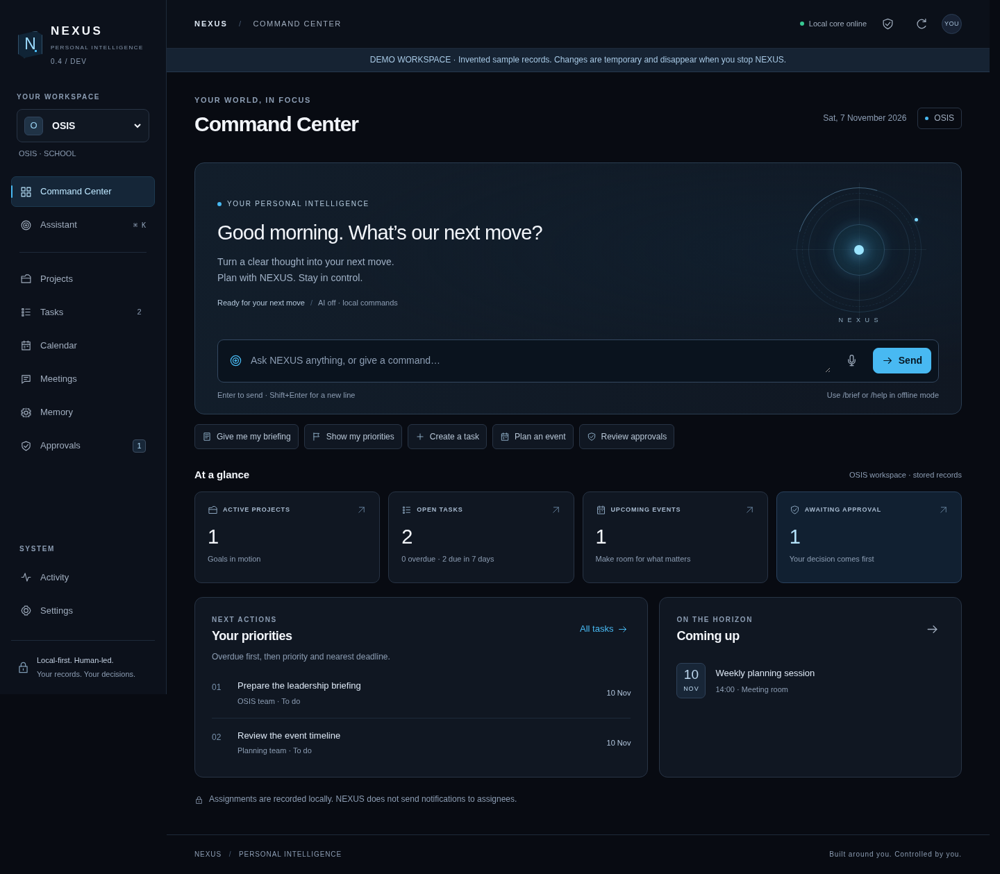

# NEXUS — Universal Personal AI Core

NEXUS is a local-first personal AI operating system and executive assistant.
OSIS is the first operational workspace; the same Core also provides independent
containers for Personal, Academic, Research, Development, Finance and ATLAS.

**v0.5 cognitive Core / Mission 003:** Python-first, one trusted local operator,
no required cloud service. Persistent command lifecycle, approved executive
workflows and encrypted administrative backups extend the v0.4 dashboard.
External accounts, scheduling and specialist execution remain disabled.

## Mission 003 — backend for Project JARVIS

- Grounded English/Indonesian/mixed command routing, bounded context and replaceable model provider.
- Persistent command/plan states, verified results, conflict checks and atomic approvals.
- Explicit project → milestone → task relationships, dependencies and completion timestamps.
- Structured meetings, separately approved decisions and confirmed follow-up tasks.
- Categorized memory with provenance, duplicate/conflict warnings and stale-information handling.
- Real local briefings and tested encrypted SQLite backup/restoration through a private CLI.

The frontend is being developed independently by Claude. **This mission changes
no frontend files.** New records can be accessed through additive APIs; existing
UI panels still expose the Mission 002 subset. No deployment or MacBook upgrade
is performed automatically.

[Development report](docs/MISSION_003_REPORT.md) ·
[Claude API contract](docs/API_CONTRACT.md) ·
[Frontend integration guide](docs/FRONTEND_INTEGRATION_GUIDE.md) ·
[Cognitive architecture and memory](docs/COGNITIVE_CORE.md) ·
[Private backup/recovery](docs/DATA_SAFETY.md)

## Mission 002 — Command Center redesign

The new interface adds a command-first home screen with a restrained AI Core,
a focused Assistant, Projects, Tasks, Calendar, Meetings, Memory, Approvals,
Activity and Settings. It remains local-first with explicit approval for writes.
Workspace switching, search, provenance and mobile layouts use real Core records.

[Simple ZIP/demo walkthrough](docs/USER_INTERFACE_GUIDE.md) ·
[Design system](docs/UI_DESIGN_SYSTEM.md) ·
[Mission 002 report and screenshots](docs/MISSION_002_REPORT.md)



## See the dashboard safely

With Python 3.11+ installed, open a terminal in this repository and run:

```bash
python3 app.py --demo
```

Open **http://127.0.0.1:8765**. Demo mode uses invented records in a temporary
directory, disables cloud AI, and discards changes when the app stops. It never
opens your normal OSIS database. Use the workspace selector, Projects, Memory,
Chief of Staff and Approval inbox to inspect the new workflows.

For an ordinary persistent local session:

```bash
python3 app.py
```

The existing OSIS path (`data/nexus.sqlite3`, `NEXUS_DB` or `--db`) is retained.
Other workspace databases live under `data/workspaces/` by default.
`Control+C` stops the server. Use `--port 8766` if necessary.

**Existing installation:** stop the old app and keep a private full SQLite
snapshot before upgrading. Schema 2 adds tables transactionally without changing
existing table columns or IDs. Test against a copy first. See the
[migration notes](docs/DATABASE_MIGRATIONS.md) and [backup CLI](docs/DATA_SAFETY.md).
Never upload your database or exports to GitHub.

## Implemented now

- Modular reusable `nexus/` Core with compatible `core.py` imports.
- Independent workspace databases, trusted grants and ownership checks.
- Navy responsive dashboard: overview, assignments, projects, calendar, notes,
  memory, assistant and approvals; safe per-request workspace selection.
- Existing OSIS task/delegation/status, event, note and briefing commands.
- Projects, milestones, linked tasks, acyclic prerequisites and structured meeting records.
- Structured facts: approved create/update/delete, categories, provenance,
  timestamps, optional validity date and exact duplicate/conflict diagnostics.
- Literal search of facts, projects, notes and persisted conversation history.
- Central command/model planner with a fixed tool registry, visible plan reports
  and atomic plans of 1–5 local writes behind one explicit approval.
- Expiring one-time approval tokens, transaction rollback and local audit.
- Business-record JSON exports and private encrypted full SQLite recovery CLI;
  calendar `.ics` export remains manual.
- Optional cloud AI only with explicit opt-in; offline commands always available.
- Existing browser dictation/TTS controls; external dictation requires confirmation.
- Standard-library unit/HTTP tests, optional browser smoke, and CI configuration.

No unrestricted shell/file tools, automatic sending, payment, trading, cloud sync,
agent swarm, authentication or encrypted live database are implemented. Other workspaces
are functional generic containers, without specialist domain applications.

## Commands

```text
/help
/brief
/tasks
/task add Prepare proposal | OSIS team | 2026-11-20 | high
/task doing 1
/task done 1
/task assign 1 | Planning team
/event add Planning session | 2026-11-21 | 14:00 | Meeting room | Review owners
/note add Planning notes | Confirm responsibilities before publishing
/project add Research roadmap | Compare local AI options
/projects
/remember Meeting rhythm | Weekly
/search roadmap
/forget Meeting rhythm
/audit
NEXUS, status report.
NEXUS, apa aja yang belum selesai dari proker OSIS?
NEXUS, what were our previous decisions?
NEXUS, what did we finish this week?
```

Every business-record change is proposed first. Review its full details in Approval
inbox before approving. Chat, proposals and audit records are saved as operational
history without a second confirmation.

In the assistant, use Shift+Enter for a multistep plan:

```text
/plan
/task add Compare local models | Research owner
/project add Local AI evaluation | Compare latency and privacy
/remember Research preference | Local-first
```

All steps commit together after approval or roll back together on failure. General
plans cannot reference newly generated task IDs or include external actions.
The typed `create_project_plan` proposal additionally creates one linked project
with up to five milestones and twenty tasks using explicit array positions.

Terminal-only mode:

```bash
python3 app.py --cli --workspace personal
```

Enter `/plan` in the CLI, then each step on its own line and a blank line to finish.

## Optional natural-language AI

Offline and demo sessions need no dependencies. To opt in to OpenAI:

```bash
python3 -m pip install -r requirements-ai.txt
python3 app.py --enable-ai
```

Set `OPENAI_API_KEY` in your local environment first; never put it in source or
Git. `NEXUS_MODEL` defaults to `gpt-4.1-mini`; `NEXUS_TIMEZONE` defaults to
`Asia/Jakarta`. Key presence alone does not enable AI. Opt-in sends bounded context
and recent chat from the active workspace to the provider. No paid API requests
were made during development; provider behavior is tested with fakes.

Browser speech recognition may use a separate external service and is independent
of the OpenAI flag. Review dictated text before sending. Real microphone behavior
on the owner's device has not been tested.

## Development and verification

```bash
python3 -m unittest discover -s tests -v
python3 -m compileall -q app.py core.py nexus tests
node --check web/app.js
```

The regression suite uses temporary invented records and loopback HTTP only.
Install `requirements-security.txt` before running the full suite, which includes
real authenticated-encryption recovery tests. The ordinary app does not require it.
Run `node --test tests/frontend.test.mjs` for the dependency-free browser domain tests.
For the optional UI smoke check, install Playwright in a development environment
with Chromium at `/usr/bin/chromium`, then run `python3 tests/browser_smoke.py`.
The runtime itself does not need Playwright or Node. `python3 tests/browser_redesign.py`
adds the full Mission 002 journeys; `python3 tests/capture_ui.py` captures sample-data
screenshots. See the testing guide for prerequisites and limits.

[Architecture](docs/NEXUS_CORE_ARCHITECTURE.md) ·
[Implementation plan](docs/IMPLEMENTATION_PLAN.md) ·
[Mission report](docs/MISSION_001_REPORT.md) ·
[Security](docs/SECURITY_AND_PRIVACY.md) ·
[Testing](docs/TESTING_AND_RELEASES.md)

Older roadmap documents describe long-term goals; the Mission 003 report
identifies exactly what this iteration ships. This remains a localhost
prototype, not a production school or company system. Local account security is
the trust boundary. JSON export excludes history/proposals and has no restore UI;
use the private encrypted SQLite CLI for full recovery. Live model calls, Mac
audio and third-party account integrations were not verified or enabled.
