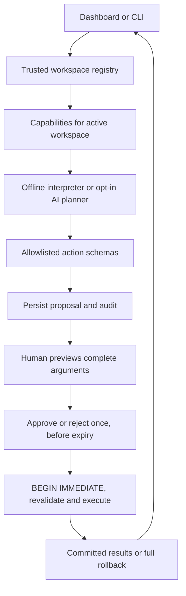

# NEXUS Core — Mission 001 architecture

Historical Mission 001 baseline. Mission 003 adds schema 2 and the working
[cognitive Core](COGNITIVE_CORE.md), [API contract](API_CONTRACT.md) and
[data safety](DATA_SAFETY.md). Those documents describe current behavior.

Status: implemented first iteration, v0.3 prototype. Mission 002 adds the [v0.4 interface system](UI_DESIGN_SYSTEM.md) and additive API metadata/proposal contracts without a schema migration. NEXUS is a universal personal
AI operating system foundation; OSIS is its first operational workspace.

## Repository audit

The baseline (`40683aec69229ee0edc62e53e579d82248f00f38`) contains a standard-library
Python HTTP/CLI app, a 473-line `core.py`, vanilla browser assets, 21 regression
tests, and an optional OpenAI dependency. Its SQLite tables are tasks, events,
notes, memories, pending_actions, audit and messages. No user database or
credentials were present or read. OSIS commands, exports, briefings, task
assignment/status transitions, speech controls and approval behavior must remain.

Risks found: OSIS-specific orchestration, one global store, no workspace grants,
no versioned migrations, no project records, no memory provenance/deletion/search,
API-key presence implicitly enabling cloud context disclosure, and dashboard
limits also truncating backup exports. Existing security controls worth retaining:
loopback binding, Host/Origin checks, JSON/custom-header checks, text-only DOM
rendering, explicit SQL operations, argument validation and serialized approvals.
Some older documents described CI/ignore files which were absent from the source
tree; this iteration adds the actual files.

## Modules and ownership

| File | Responsibility |
|---|---|
| `app.py` | Loopback HTTP, CLI, startup options and explicit workspace routing |
| `core.py` | Compatibility facade for existing OSIS Python imports |
| `nexus/commands.py` | Deterministic interpreter; dry-run collection of plan steps |
| `nexus/orchestrator.py` | Scoped context, opt-in model planner, proposals and result reports |
| `nexus/tools.py` | Complete model tool manifest; no dynamic plugin execution |
| `nexus/validation.py` | Allowlist and normalized schemas for every action/step |
| `nexus/permissions.py` | Capability checks shared by storage and workspace registry |
| `nexus/workspaces.py` | Trusted IDs, domains, independent database paths and grants |
| `nexus/storage.py` | Task/event/note/project/memory repositories; approval engine and audit |
| `nexus/migrations.py` | Versioned additive, transactional SQLite initialization |
| `nexus/interfaces.py` | Future specialist, voice and integration protocol contracts |
| `nexus/demo.py` | Explicit temporary demo fixtures, with no real-data access |
| `web/` | Responsive navy dashboard, projects, workspace selector, search and approval UI |

Keeping the approval engine and repositories together makes their transaction
boundary explicit without introducing a service framework or distributed agents.
The Core imports neither the HTTP server nor browser assets. Offline execution
requires only the Python standard library.

## Request and execution flow

No model tool can approve actions, select database paths, grant permissions,
execute shell commands, access arbitrary files, contact people or spend money.
A model receives bounded context from exactly one already-authorized Store.
`OPENAI_API_KEY` alone does not activate disclosure: startup must explicitly use
`--enable-ai`, and the workspace must have the `ai` capability. Natural-language
replies are labeled drafts; program results come from database operations.

Plans have 1–5 validated local writes, one expiry token and one human decision.
`execute_plan` runs all steps in the same SQLite transaction, including memory
provenance and audit. An invalid/missing record in any step rolls back all steps;
the proposal remains pending so it can be rejected. Nested plans and unsupported
actions are rejected before persistence. No automatic retries occur.

Task IDs in plans must refer to existing records; there are no symbolic references
to newly created IDs, background jobs, external effects or dependency scheduler.

## Workspaces and permission model

| ID | Label | Domain | Database |
|---|---|---|---|
| `osis` | OSIS | school | Existing `--db` / `NEXUS_DB` path |
| `personal` | Personal | personal | `<workspace-root>/personal/nexus.sqlite3` |
| `academic` | Academic | school | `<workspace-root>/academic/nexus.sqlite3` |
| `research` | Research | personal | `<workspace-root>/research/nexus.sqlite3` |
| `coding` | Development | personal | `<workspace-root>/coding/nexus.sqlite3` |
| `finance` | Finance | personal | `<workspace-root>/finance/nexus.sqlite3` |
| `atlas` | ATLAS | company | `<workspace-root>/atlas/nexus.sqlite3` |

The default workspace root is beside the OSIS database, under `workspaces/`.
Only an allowlisted ID can be supplied over HTTP (`?workspace=personal`). Paths,
domains and capability grants come from host startup code. No global mutable
active workspace exists; each request scopes itself. Switching in the browser
reloads the page, clearing drafts and avoiding stale cross-workspace actions.
Workspace identity is stamped in each DB; opening it under a different workspace
fails. Configured paths must be distinct. Exports and calendar event UIDs include
the active workspace. History, memory, approvals, audit and AI context stay scoped.

Capabilities:

- `read`: state, search, context and workspace listing.
- `propose`: chat/history recording and new proposals; no business-record execution.
- `approve`: approve/reject an existing proposal in this workspace.
- `export`: JSON and calendar export, in addition to read access.
- `ai`: external model disclosure, additionally gated by startup opt-in.

The default single local owner has all capabilities in every workspace. Independent
restricted grants can be passed to `WorkspaceRegistry(..., grants={...})` by trusted
host code. HTTP clients/models cannot edit grants. This is application separation
for one trusted OS account, **not** authenticated multi-user authorization or a
sandbox against arbitrary Python code or a user who can read local files.

## Persistence and legacy compatibility

Existing tables, column order and integer IDs are retained. New tables:
`workspace_identity`, `projects`, `nexus_schema`, `pending_metadata` and
`memory_metadata`. Version 1 initialization creates/backfills these additively in
one transaction. Ownership and future schema versions are checked before DDL;
failures roll back new tables. Legacy memory gets `source=legacy`; legacy approval
tokens remain usable. No original rows are deleted or rewritten by migration.

Saved facts remain in the existing `memories(key,value,updated_at)` table.
Provenance lives in a sidecar with creation/approval timestamps, trusted source
(`command`, `ai`, `legacy`) and approval ID. AI suggestions enter facts only after
approval. `/remember` creates or updates, `/forget` deletes after approval, and
foreign-key cascade removes the deleted fact's provenance. Deletion does not erase
historical chat, proposal payloads, audit descriptions or existing exports; secure
erasure/retention is future work.

Search uses parameterized literal substring queries, escapes `%`, `_` and `\`, and
returns at most 50 matches per category (facts/projects/notes/history). It is not
semantic search, and SQLite's default case matching is primarily ASCII-aware.
Dashboard lists remain bounded. JSON export includes all business records and
local audit entries; it deliberately excludes chat and pending approvals. It is a
record export, not a restorable full SQLite backup. `.ics` retains the existing
floating local-time behavior and bounded event listing.

Stop the old app and back up the entire database file privately **before running
an upgrade on real records**. Development and tests use temporary invented data.
To roll back, restore that private pre-upgrade copy with the old code; do not run
old code against new `execute_plan`/`forget` proposals or assume downgrade safety.

## Security and reliability boundaries

- Loopback only; existing Host/Origin and custom JSON-header checks retained.
- Fixed SQL and server-side revalidation; text-only browser rendering.
- `BEGIN IMMEDIATE` prevents replay/racing approvals; audit and writes commit together.
- Newly created DB files use owner-only permissions on supported POSIX systems;
  permissions on existing files are preserved.
- Cloud/service errors record exception categories, not provider exception text or keys.
- Raw HTTP request bodies and query contents are not logged by the request logger.
- Ignore rules exclude databases, exports, secrets, audio, logs and work files.
- The server is not authenticated; any local process may make authorized owner requests.
- No encryption at rest, log retention, API rate limiting or production deployment support.
- Browser speech can use external services and now asks before starting dictation.
  There is no always-listening recorder or bundled offline speech engine.

## Extension direction

`SpecialistAgent.plan` returns proposals, not executable powers. `VoiceInput`
produces text for the same interpreter. `Integration.preview` is a contract only;
future effectful adapters require approved manifests, minimum scopes, verified
results, idempotency and their own authorization review. No specialist agent,
external connector or OpenClaw bridge is activated by this iteration.
